<p align="center">
  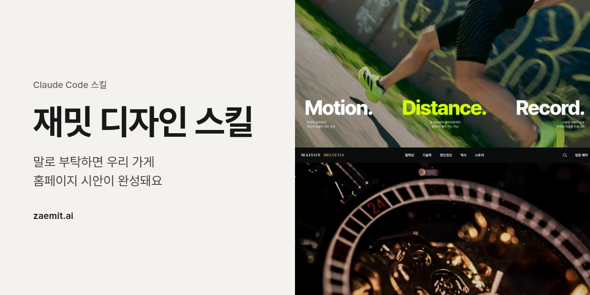
</p>

# 재밋 디자인 스킬

Claude Code에 "재밋으로 꽃집 홈페이지 디자인해 줘"라고 말해 보세요.

Claude가 가게 이야기를 듣고 사이트를 기획하고 문구를 써요. 그 기획을 받아 [재밋](https://zaemit.ai) 디자인 엔진이 화면을 만들고, 만드는 동안 필요한 판단은 Claude가 직접 해요. 대화가 끝나면 브라우저에서 바로 열어 볼 수 있는 홈페이지 시안이 남아요.

재밋은 어느 가게에나 같은 화면을 찍어 내지 않아요. 가게마다 어울리는 분위기를 먼저 정하고, 글꼴과 색, 여백, 사진, 움직임을 그 분위기에 맞춰 한 벌로 다듬어요. 한글 제목이 어디서 줄을 바꾸는지, 사진 한 장이 그 칸에 정말 맞는지까지 살펴서, 디자인 스튜디오에 맡긴 것처럼 완성도 있는 사이트를 만들어요.

가입도, API 키도 필요 없어요.

[바로 시작하기](#바로-시작하기) · [만든 예](#이렇게-만들어져요) · [제작사례](#재밋으로-만든-사이트) · [재밋 디자인이 다른 점](#재밋-디자인이-다른-점) · [시안 다음에는](#시안-다음에는-재밋에서-이어서) · [자주 묻는 질문](#자주-묻는-질문) · [English](#english)

## 바로 시작하기

```bash
git clone https://github.com/zaemitai/zaemit-design-skill ~/.claude/skills/zaemit-design
pip install Pillow
```

Claude Code를 다시 열고 이렇게 말하면 됩니다.

```
재밋으로 꽃집 홈페이지 디자인해 줘
```

## 이렇게 만들어져요

"재밋으로 꽃집 홈페이지 디자인해 줘" 한 문장으로 만든 시안이에요. 가게 이름과 문구는 Claude가 쓰고, 사진은 상업적으로 쓸 수 있는 무료 사진 가운데 Claude가 한 장씩 보고 골랐어요.

<p align="center">
  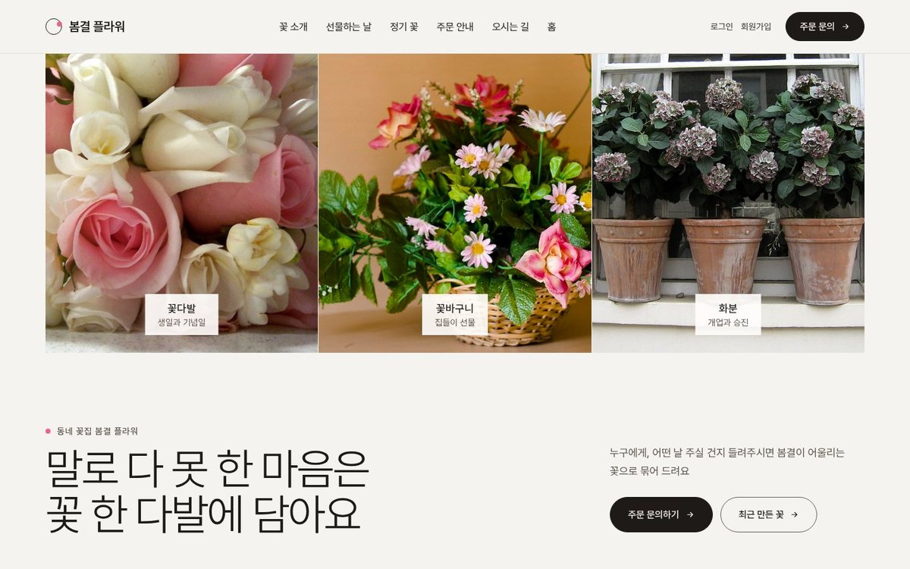
  &nbsp;
  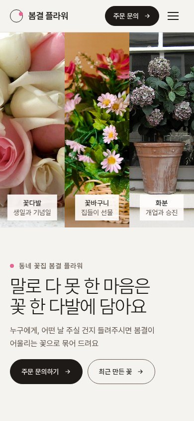
</p>

<sub>캡처 속 사진: Sailor Coruscant (<a href="https://www.flickr.com/photos/30325243@N00/2949945463">원본</a>, CC BY 2.0) · Hafiz Issadeen (<a href="https://www.flickr.com/photos/25902645@N08/4432352238">원본</a>, CC BY 2.0) · Spencer Means (<a href="https://www.flickr.com/photos/28643687@N08/31084269956">원본</a>, CC BY-SA 2.0). 이 캡처 이미지는 CC BY-SA 2.0을 따릅니다.</sub>

시안이 끝나면 Claude가 이렇게 정리해 알려 줘요.

- **제작 완료 및 설명**: 시안 링크, 메인 섹션 구성, 디자인의 느낌, 정하지 않고 비워 둔 사실
- **사진 출처**: 칸마다 사진, 작가, 라이선스, 그리고 써도 되는지
- **검사**: 글자색 대비처럼 다듬으면 좋은 곳
- **계속 제작하는 방법**: HTML로 받기, 재밋에 올려 이어서 만들기

## 재밋으로 만든 사이트

이 스킬도 같은 재밋 디자인 엔진으로 만들어요. 사진을 누르면 실제 사이트가 열립니다.

<table>
  <tr>
    <td width="33%" valign="top">
      <a href="https://wv1785200637788479.zaemit.ai/">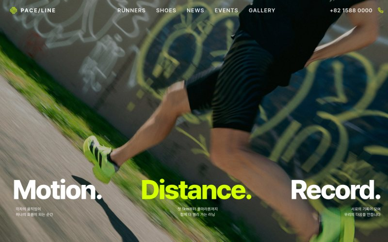</a>
      <b>PACE/LINE</b><br><sub>러닝화·기능성 웨어 브랜드</sub>
    </td>
    <td width="33%" valign="top">
      <a href="https://wv1785213080673546.zaemit.ai/">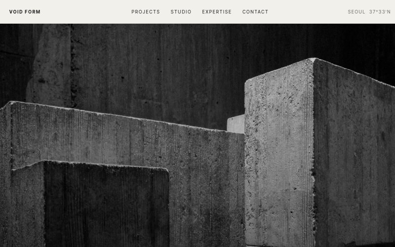</a>
      <b>VOID FORM</b><br><sub>비움에서 출발하는 건축 스튜디오</sub>
    </td>
    <td width="33%" valign="top">
      <a href="https://wv1785213084299043.zaemit.ai/">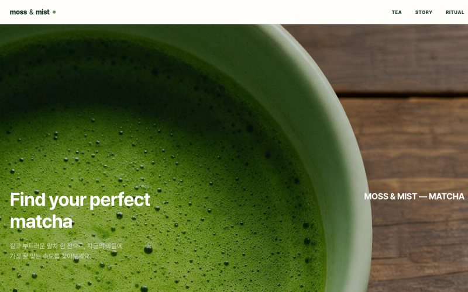</a>
      <b>MOSS &amp; MIST</b><br><sub>기분에 맞는 말차를 골라 주는 말차 브랜드</sub>
    </td>
  </tr>
  <tr>
    <td width="33%" valign="top">
      <a href="https://wv1784621569517391.zaemit.ai/">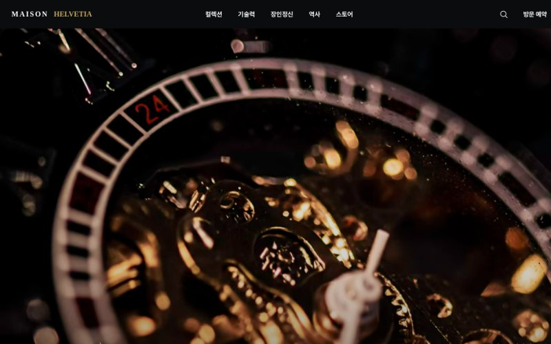</a>
      <b>Maison Helvetia</b><br><sub>제네바 시계 메종의 브랜드 사이트</sub>
    </td>
    <td width="33%" valign="top">
      <a href="https://wv1784595875172631.zaemit.ai/">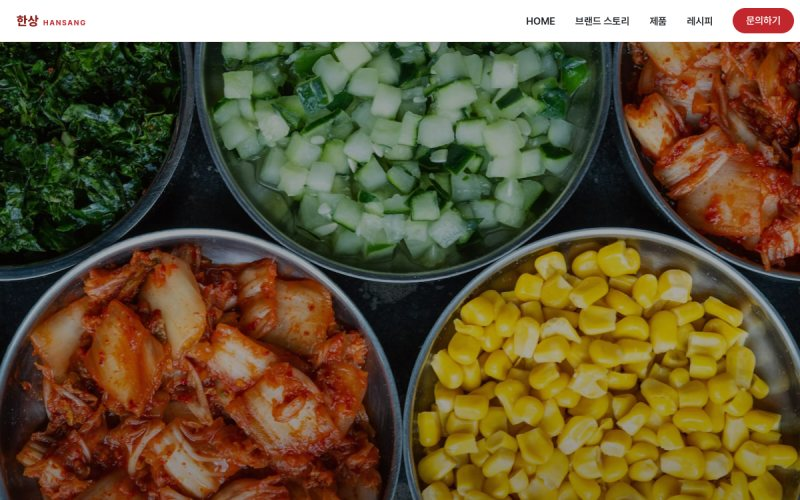</a>
      <b>한상 HANSANG</b><br><sub>김치·장류·한과를 파는 전통식품 브랜드</sub>
    </td>
    <td width="33%" valign="top">
      <a href="https://wv1784594445010792.zaemit.ai/">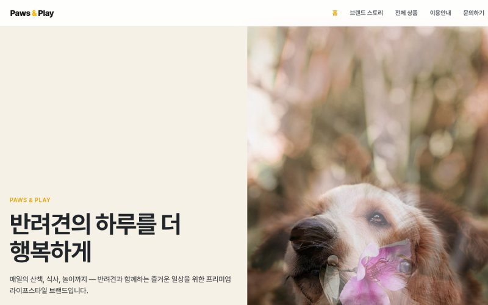</a>
      <b>Paws &amp; Play</b><br><sub>프리미엄 애견용품 쇼핑몰</sub>
    </td>
  </tr>
</table>

더 많은 사례는 [재밋 제작사례](https://zaemit.ai/showcase)에서 볼 수 있어요.

## 재밋 디자인이 다른 점

### 같은 꽃집이라도 가게마다 다른 모습으로

<table>
  <tr>
    <td width="50%" valign="top">
      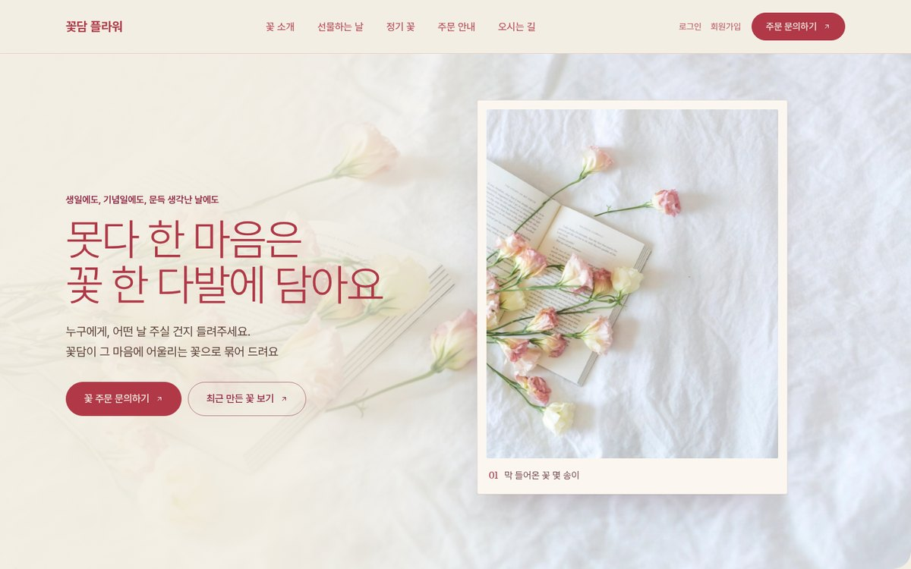
      <b>꽃담 플라워</b><br><sub>꽃잎이 비치는 분홍빛 바탕 위로, 액자 속 꽃 사진이 한 장씩 바뀌어요. 제목도 꽃 색을 닮은 장밋빛이에요.</sub>
    </td>
    <td width="50%" valign="top">
      
      <b>봄결 플라워</b><br><sub>꽃다발, 꽃바구니, 화분 사진 세 장이 나란히 놓이고, 그 아래 큰 제목과 먹색 버튼이 단정하게 자리 잡아요.</sub>
    </td>
  </tr>
</table>

둘 다 이 스킬로 만든 꽃집 시안이에요.

재밋에는 글꼴, 색, 여백, 사진 분위기, 움직임까지 한 벌로 맞춘 디자인 시스템이 50가지가 넘게 있어요. 엔진은 가게가 하는 일과 바라는 분위기를 보고 어울리는 디자인 시스템을 정한 뒤, 이 가게만의 섹션, 문구, 사진으로 사이트를 새로 만들어요. 업종이 바뀌면 화면의 결도 크게 달라져요.

- 호텔이라면, 해 질 녘 호박빛 조명과 모래빛 면 위로 사진이 천천히 겹쳐 바뀌고 글이 부드럽게 떠올라요.
- 법률사무소라면, 밤의 먹색과 종이색 면이 크게 번갈아 흐르고 저녁 조명 속 사진이 어둠에서 천천히 떠올라요.
- 학원이라면, 크림색 공책 같은 면 위에 굵은 두 줄 제목이 놓이고 한 낱말 아래로 빨간 펜 밑줄이 그어져요.

그래서 같은 꽃집이라도, 같은 업종이라도 늘 같은 모습으로 나오지 않아요.

### 첫 화면부터 문의까지, 한 편의 이야기로

첫 화면만 공들이고 아래는 비슷한 칸을 늘어놓는 사이트가 많아요. 재밋은 메인 전체를 손님이 읽어 내려가는 이야기로 기획해요. 홈페이지형 메인은 맨 위 메뉴와 맨 아래 안내를 빼고 10~15개 섹션으로 짜고, 무엇을 하는 곳인지, 무엇을 주는지, 왜 믿을 수 있는지가 차례로 드러난 뒤 찾아오는 길과 문의로 이어져요.

위의 봄결 플라워 메인은 이렇게 흘러가요.

1. 말로 다 못 한 마음은 꽃 한 다발에 담아요
2. 꽃을 고르기 전에 받는 분을 먼저 떠올려요
3. 선물할 꽃부터 집에 둘 꽃까지 만들어요
4. 이런 날엔 꽃이 **말**을 대신해요 (생일, 기념일, 개업과 승진, 졸업과 입학, 고마운 마음)
5. 계절마다 **꽃**이 바뀌어요
6. 처음 주문해도 차례대로 하나씩 여쭤볼게요
7. 정해 둔 날마다 **새 꽃**이 찾아가요
8. 건네는 순간을 위해 꼭 지키는 네 가지
9. 다른 분들이 고른 꽃을 먼저 구경해 보세요
10. 꽃을 **오래** 보는 방법
11. 자주 묻는 질문
12. 찾아오시는 길
13. 꽃 주문 문의

섹션 제목은 손님에게 말을 건네듯 쓰고, 강조할 낱말 하나만 굵게 표시해요. 훑어 내려가기만 해도 이 가게가 어떤 곳인지 금세 알 수 있어요.

### 장면처럼 흐르는 움직임

<p align="center">
  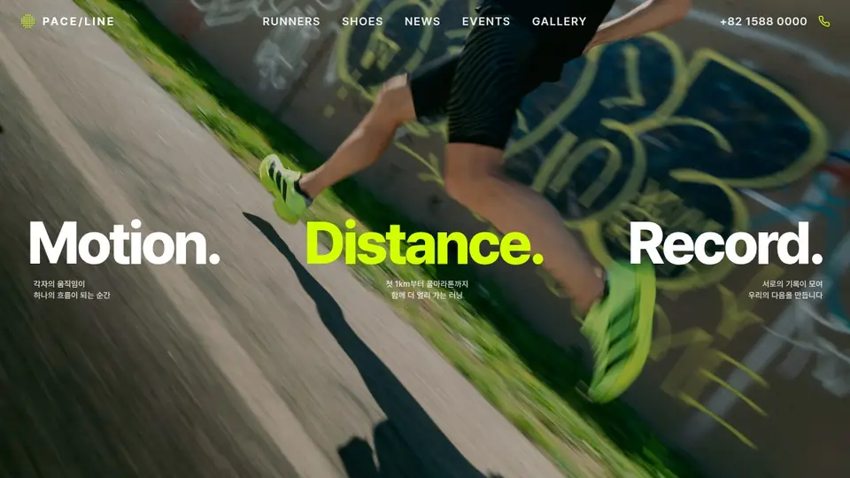
</p>

<sub>재밋 제작사례 PACE/LINE의 첫 화면을 스크롤하는 모습이에요. 함께 달리는 사람들 사이로 문구가 떠오르고, 해 질 녘 언덕을 달리는 한 사람을 따라 거리가 0km에서 10km까지 올라가요.</sub>

- 장면형 첫 화면은 스크롤하는 동안 사진과 글이 다음 장면으로 넘어가며 이야기를 이어 가요.
- 사진은 블라인드처럼 옆으로 밀려나지 않고 스며들듯 바뀌어요. 화면이 정신없이 흔들리지 않게, 움직임은 늘 차분하게 잡아요.
- 기기에서 '동작 줄이기'를 켠 방문자에게는 움직임 없이 정돈된 화면을 보여 줘요.

### 한글이 예쁘게 보이도록

- 한글은 Pretendard 한 가지로 써요. 방문자 컴퓨터의 기본 글꼴로 바뀌어 엉뚱하게 보이는 일이 없어요.
- 영문 제목 글꼴을 쓰는 자리에 한글이 들어와도, 한글은 Pretendard로 나와서 모양이 무너지지 않아요.
- 제목은 낱말 단위로 줄을 바꾸고, 두 줄짜리 제목은 두 줄 길이를 고르게 나눠요. "수확 즉 / 시 출고"처럼 낱말이 쪼개지지 않아요.
- 한글은 같은 크기의 영문보다 넓고 촘촘해 보여요. 그래서 제목 크기를 한글에 맞춰, 넓은 화면에서도 휴대폰에서도 한두 줄로 읽히게 잡아요.

### 색은 지어내지 않아요

- 원하는 색을 말하면 그 색을 그대로 써요.
- 말하지 않으면 검증된 색 목록(Tailwind CSS·Radix 색 단계) 가운데, 업종과 분위기에 어울리고 그 디자인에 입혔을 때 보기 좋은 색만 써요. 그럴듯해 보이는 색 코드를 AI가 새로 지어내지 않아요.
- 다 만든 뒤에는 글자와 바탕의 색 대비를 검사해, 다듬으면 좋은 곳을 알려 줘요.

### 사진은 칸마다 직접 보고

- 섹션마다 무엇이, 어떤 장면과 분위기로 담겨야 하는지 사진 설명을 먼저 써요.
- 후보 사진은 Claude가 한 장씩 보고 그 칸에 맞는 것만 넣어요. 같은 사진을 두 번 쓰지 않고, 맞는 사진이 없으면 엉뚱한 사진을 넣지 않고 그 자리를 비워 둬요.
- 사진 여러 장을 나란히 둘 때는 모양을 섞지 않고, 붙여 놓은 사진 사이로 바탕이 비치지 않게 맞춰요.

### 문구는 손님이 쓰는 말로

- 업계 말과 어려운 한자어는 손님이 쓰는 쉬운 말로 바꿔요. 기장은 "장부 정리"로, 통기성은 "바람이 잘 통함"으로 써요.
- 말하지 않은 가격, 주소, 전화번호, 영업시간은 지어내지 않아요. 자리만 잡아 둔 예시 값이 있으면 무엇인지 따로 알려 드려요.

### PC에서도 휴대폰에서도

<p align="center">
  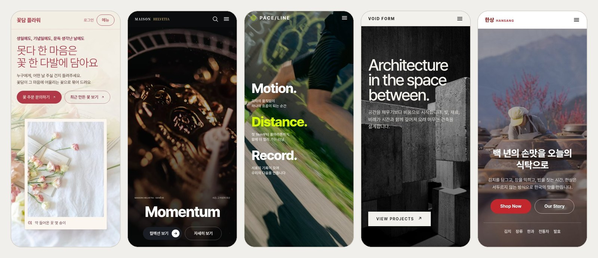
</p>

<sub>왼쪽부터 꽃담 플라워(이 스킬로 만든 시안), Maison Helvetia, PACE/LINE, VOID FORM, 한상의 휴대폰 첫 화면이에요.</sub>

- 같은 시안이 휴대폰 화면에 맞게 다시 구성돼요. PC에서 옆으로 놓였던 사진과 글은 위아래로 놓이고, 큰 제목은 좁은 화면에서도 칸 밖으로 넘치지 않게 크기를 잡아요.
- 표는 휴대폰에서 카드처럼 세로로 쌓여, 옆으로 밀어 보지 않아도 한눈에 읽혀요.

## 이렇게 말해 보세요

```
재밋으로 꽃집 홈페이지 디자인해 줘
```

```
재밋으로 성수동 필라테스 스튜디오 랜딩 페이지 만들어 줘. 차분하고 고급스럽게.
```

```
재밋으로 우리 세무사무소 홈페이지 시안 만들어 줘. 이 사이트 느낌을 참고해 줘: https://example.com
```

```
Design an English homepage for our guesthouse in Seoul with Zaemit.
```

이런 것을 함께 말하면 더 정확해져요.

- **가게 이름, 하는 일, 사이트 형태**(홈페이지형 또는 랜딩형): 말해 주면 되묻지 않고 바로 만들어요.
- **주소, 전화번호, 영업시간, 가격**: 말해 준 그대로 들어가요. 말하지 않으면 지어내지 않아요.
- **가게 사진**: 함께 주면 무료 사진보다 먼저 써요.
- **참고하고 싶은 사이트 주소**: 그 사이트의 분위기와 화면 짜임을 살펴 반영해요.

## 시안 다음에는 재밋에서 이어서

재밋은 시안을 만들고 끝나는 도구가 아니에요. 마음에 드는 시안은 재밋에 올려, 손님을 맞는 진짜 사이트로 키울 수 있어요. 시안 끝에 나오는 **재밋에 올리기** 링크로 로그인하면, 바로 고칠 수 있는 코드를 받아 이어서 만들어요.

- **고칠 곳만 말로**: 전체를 다시 만들 필요 없이 고칠 섹션만 AI에게 말해요. 바뀐 내역이 남아서 언제든 이전으로 되돌릴 수 있어요.
- **직접 고치기**: 웹 에디터에서 문구, 사진, 링크를 직접 바꾸고 바로 확인해요.
- **서브페이지와 데이터베이스**: 메인에 이어 서브페이지를 만들고, 데이터와 관리자 화면까지 연결해요.
- **"게시판 넣어 줘" 한마디로**: 기능을 말하면 데이터를 담을 곳과 관리자 화면까지 함께 만들어져요. 지금 쓸 수 있는 기능은 17가지예요.
  - 게시판, 문의·신청 폼, 예약, 지도·오시는 길, 상품 관리, 주문 관리, 배송 관리, 결제, 쿠폰, SNS 로그인, 고객 알림 발송(문자·알림톡·이메일), 상담 버튼·위젯, 동영상 강의, 미디어 넣기(유튜브·인스타그램 등), 마케팅 픽셀·전환 추적, 웹훅·자동화, 검색·AI 노출(구글·네이버 등록, SEO·AEO)
- **팀이 함께**: 팀원을 초대하고 역할과 권한을 나눠, 기획부터 수정과 운영까지 한 워크스페이스에서 같이 봐요.
- **반복 운영은 AI가**: 들어오는 문의와 예약, 콘텐츠·팝업·게시판 요청을 콘솔에서 AI가 처리하고, 판단이 필요한 일은 사람이 함께해요.
- **대화로 운영**: 재밋 커넥터(`https://zaemit.ai/mcp`)를 Claude에 연결하면 대화하면서 사이트를 계속 고치고 운영할 수 있어요. 연결하는 법은 [재밋 MCP 연결 안내](https://mcp.zaemit.ai/)에 있어요.

재밋에 올리지 않고 **HTML 받기**로 파일을 받아 직접 고치고, 서브페이지를 이어서 만들어도 됩니다.

다른 AI 빌더가 빠른 초안에서 멈출 때, 재밋은 수정과 데이터, 관리자 기능, 운영까지 한 흐름으로 이어 가요. 남들은 만들기까지, 재밋은 운영까지 함께해요.

## 어떻게 만들어지나요

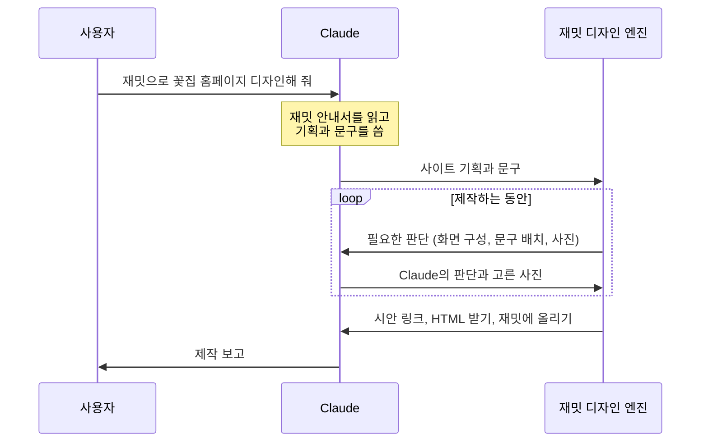

기획 규칙(섹션 수, 문구 쓰는 법, 사진 설명 쓰는 법)은 이 저장소에 옮겨 적지 않아요. Claude가 시안을 만들 때마다 [재밋 안내서](https://zaemit.ai/design?format=json)를 읽고 따르므로, 규칙이 좋아지면 스킬을 다시 받지 않아도 시안이 함께 좋아져요.

## 사진과 라이선스

사진은 이 순서로 정해요.

1. 사용자가 준 사진
2. Claude가 사진을 만들 수 있는 환경이면 칸 설명대로 만든 사진
3. 상업적으로 쓸 수 있는 무료 사진: [Openverse](https://openverse.org)에서 찾고, 없으면 [위키미디어 공용](https://commons.wikimedia.org)에서 찾아요. Unsplash나 Pexels API 키가 있으면 그쪽 사진을 써도 돼요.

작가 표기가 필요한 사진(CC BY 등)은 시안 맨 아래에 작가와 라이선스가 자동으로 적혀요. 제작 보고에서는 칸마다 어떤 라이선스인지, 써도 되는지, 잘 맞은 사진과 아쉬운 사진이 무엇인지 알려 드려요.

무료 사진의 라이선스는 사진 속 사람의 초상권이나 간판·상표까지 허락하지 않아요. 실제로 쓰실 때는 가게에서 직접 찍은 사진으로 바꾸는 것을 권해요.

## 보내는 정보

시안을 만들면서 스크립트가 바깥으로 보내는 것은 이것뿐이에요. 계정 정보나 API 키는 보내지 않아요.

| 보내는 곳 | 보내는 것 |
|---|---|
| `zaemit.ai` | 사이트 기획과 문구, 제작 중 판단에 대한 Claude의 답, 넣을 사진의 주소와 출처 |
| `api.openverse.org`, `commons.wikimedia.org` | 사진 검색어(영어 낱말 몇 개) |

시안 링크는 링크를 아는 사람이면 누구나 열 수 있어요. 아직 공개하면 안 되는 정보는 넣지 마세요.

## 자주 묻는 질문

**가입해야 하나요?**
시안까지는 가입도 API 키도 필요 없어요. 재밋에 올려 이어서 만들 때 로그인하면 돼요.

**사이트를 실제로 공개하려면요?**
재밋에 올린 뒤 이용권으로 공개해요. 자세한 내용은 [요금제](https://zaemit.ai/pricing)에서 볼 수 있어요.

**Claude Code 말고 다른 AI에서도 되나요?**
claude.ai, ChatGPT, Gemini 대화창에서는 "zaemit.ai/design 읽고 우리 가게 홈페이지 시안 만들어줘"라고 말해 보세요. AI가 시안 링크를 만들어 주고, 링크를 누르면 시안이 만들어져요. 이 스킬은 Claude Code처럼 명령을 실행할 수 있는 환경에서 Claude가 처음부터 끝까지 직접 만들 때 써요.

**영어 사이트도 되나요?**
네. 한국어가 기본이고, 영어처럼 다른 언어로도 만들어요.

**시안을 고치고 싶어요.**
바라는 점을 말하면 Claude가 기획을 고쳐 새 시안을 만들어요. 섹션 하나만 고치고 싶다면 재밋에 올려 AI 수정이나 웹 에디터를 쓰면 돼요.

**시안은 언제까지 볼 수 있나요?**
시안은 보관 기간이 지나면 지워져요. 마음에 들면 HTML로 받거나 재밋에 올려 두세요.

## 필요한 것

- Python 3.8 이상
- [Pillow](https://pypi.org/project/Pillow/): 사진 후보를 한 장으로 모아 Claude가 보고 고를 때 써요 (`pip install Pillow`)
- 인터넷 연결: `zaemit.ai`, `api.openverse.org`, `commons.wikimedia.org`

업데이트는 이렇게 받아요.

```bash
git -C ~/.claude/skills/zaemit-design pull
```

## 들어 있는 것

| 파일 | 하는 일 |
|---|---|
| `SKILL.md` | Claude가 따르는 순서: 규칙 읽기 → 기획과 문구 → 시안 만들기 → 사진 고르기 → 제작 보고 |
| `scripts/zaemit_make.py` | 시안 키 받기, 시안 만들기 시작, 엔진 질문 꺼내기, 답 보내기 (표준 라이브러리만 씀) |
| `scripts/photo_candidates.py` | 상업적으로 쓸 수 있는 사진 후보를 찾아 한 장으로 모으기 |

### 설정

| 환경 변수 | 기본값 | 뜻 |
|---|---|---|
| `ZAEMIT_DESIGN_BASE` | `https://zaemit.ai/design` | 재밋 디자인 서버 주소 |
| `ZAEMIT_QUESTION_DIR` | `zaemit-q` | 엔진 질문을 꺼내 두는 폴더 |

## 문의와 기여

- 버그와 제안은 [Issues](https://github.com/zaemitai/zaemit-design-skill/issues)에 남겨 주세요. 고치는 방법을 함께 보내 주시려면 [CONTRIBUTING.md](CONTRIBUTING.md)를 먼저 읽어 주세요.
- 보안 문제는 공개 이슈 대신 [SECURITY.md](SECURITY.md)의 방법으로 알려 주세요.
- 재밋 서비스 자체에 대한 문의는 [재밋 도움말](https://zaemit.ai/help-center)과 [고객센터](https://zaemit.ai/customer-center)에서 받아요.

## 라이선스

이 저장소의 코드와 문서는 [MIT License](LICENSE)를 따릅니다. `docs/images` 안의 이미지는 따로 정한 조건을 따릅니다([docs/images/CREDITS.md](docs/images/CREDITS.md)).

'재밋'·'Zaemit' 이름과 로고는 이 라이선스가 허락하는 범위에 들어가지 않습니다. 시안을 만드는 재밋 엔진과 서비스는 이 저장소에 포함되지 않으며, [재밋](https://zaemit.ai) 서비스 [이용약관](https://zaemit.ai/terms-of-service)을 따릅니다.

---

## English

**Zaemit Design Skill** turns one conversation in Claude Code into a homepage or landing-page draft.

Ask *"Design a homepage for my flower shop with Zaemit."* Claude plans the site and writes the copy, the [Zaemit](https://zaemit.ai) design engine builds the page, and Claude makes the calls the engine needs along the way (layout per section, how copy fits each slot, which photo goes where). You get a live preview link, an HTML download, and a link to keep building on Zaemit. No sign-up or API key is needed.

```bash
git clone https://github.com/zaemitai/zaemit-design-skill ~/.claude/skills/zaemit-design
pip install Pillow
```

What makes the designs good:

- **Design systems, not one look.** More than 50 design systems, each pairing type, color, spacing, photo style and motion. The engine matches one to the business and mood, then builds the site fresh from that business's own sections, copy and photos. Two flower shops made with this skill come out with two different faces (see the screenshots above).
- **A whole page that tells a story.** A homepage main is planned as 10 to 15 sections that read top to bottom: what the business does, what it offers, why to trust it, then how to find it and get in touch.
- **Korean typography done right.** Korean text is set in Pretendard, headlines break between words and balance across lines, and title sizes are tuned for Korean on both desktop and phone. Sites in English and other languages work too.
- **No made-up colors.** Your color if you name one, otherwise a vetted palette (Tailwind CSS and Radix scales) that fits the design. Contrast is checked after the build.
- **Photos chosen by looking.** Each section gets a written photo brief; Claude looks at the candidates and only places ones that fit. Openly licensed photos are credited at the bottom of the page automatically.
- **Calm, cinematic motion.** Scenes advance as you scroll, photos dissolve rather than slide, and visitors with reduced motion turned on get a still, tidy page.
- **Honest copy.** Plain words customers use, and no invented prices, addresses, phone numbers or opening hours.

When you like a draft, upload it to Zaemit and keep going: edit one section at a time by asking the AI (with history you can roll back), fine-tune in the web editor, add sub-pages and a database, switch on 17 built-in features (boards, forms, booking, maps, shop, payments, notifications, SEO and more), work with your team in one workspace, and keep running the site from Claude through the Zaemit connector (`https://zaemit.ai/mcp`, [setup guide](https://mcp.zaemit.ai/)).

Code and docs are MIT licensed. Images in `docs/images` have their own terms, see [CREDITS.md](docs/images/CREDITS.md). "Zaemit" and its logo are not covered by the license.
