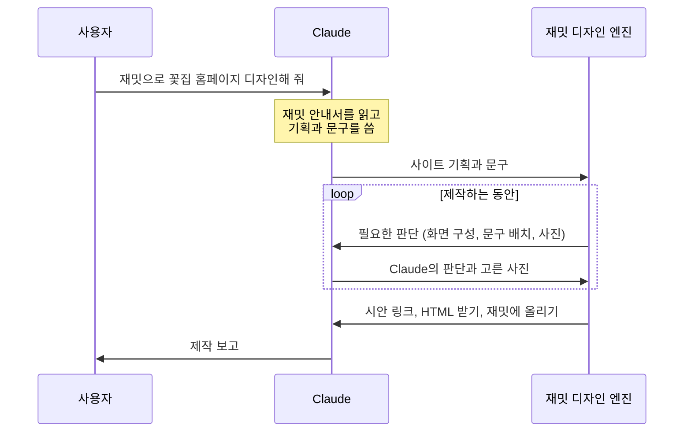

<p align="center">
  
</p>

# 재밋 디자인 스킬

Claude Code에 "재밋으로 꽃집 홈페이지 디자인해 줘"라고 말해 보세요.

Claude가 가게 이야기를 듣고 사이트를 기획하고 문구를 씁니다. 그 기획을 받아 [재밋](https://zaemit.ai) 디자인 엔진이 화면을 만들고, 만드는 동안 필요한 판단은 Claude가 직접 내립니다. 대화가 끝나면 브라우저에서 바로 열어 볼 수 있는 홈페이지 시안이 남아요.

가입도, API 키도 필요 없어요.

[바로 시작하기](#바로-시작하기) · [만든 예](#이렇게-만들어져요) · [재밋 디자인이 다른 점](#재밋-디자인이-다른-점) · [자주 묻는 질문](#자주-묻는-질문) · [English](#english)

## 바로 시작하기

```bash
git clone https://github.com/zaemitai/zaemit-design-skill ~/.claude/skills/zaemit-design
pip install Pillow
```

Claude Code를 다시 열고 이렇게 말하면 됩니다.

```
재밋으로 꽃집 홈페이지 디자인해 줘
```

## 이렇게 만들어져요

"재밋으로 꽃집 홈페이지 디자인해 줘" 한 문장으로 만든 시안이에요. 가게 이름과 문구는 Claude가 쓰고, 사진은 상업적으로 쓸 수 있는 무료 사진 가운데 Claude가 한 장씩 보고 골랐어요.

<p align="center">
  
  &nbsp;
  
</p>

<sub>캡처 속 사진: Sailor Coruscant (<a href="https://www.flickr.com/photos/30325243@N00/2949945463">원본</a>, CC BY 2.0) · Hafiz Issadeen (<a href="https://www.flickr.com/photos/25902645@N08/4432352238">원본</a>, CC BY 2.0) · Spencer Means (<a href="https://www.flickr.com/photos/28643687@N08/31084269956">원본</a>, CC BY-SA 2.0). 이 캡처 이미지는 CC BY-SA 2.0을 따릅니다.</sub>

시안이 끝나면 Claude가 이렇게 정리해 알려 줘요.

- **제작 완료 및 설명**: 시안 링크, 메인 섹션 구성, 디자인의 느낌, 정하지 않고 비워 둔 사실
- **사진 출처**: 칸마다 사진, 작가, 라이선스, 그리고 써도 되는지
- **검사**: 글자색 대비처럼 다듬으면 좋은 곳
- **계속 제작하는 방법**: HTML로 받기, 재밋에 올려 이어서 만들기

## 재밋으로 만든 사이트

이 스킬도 같은 재밋 디자인 엔진으로 만들어요. 사진을 누르면 실제 사이트가 열립니다.

<table>
  <tr>
    <td width="33%" valign="top">
      <a href="https://wv1785200637788479.zaemit.ai/"></a>
      <b>PACE/LINE</b><br><sub>러닝화·기능성 웨어 브랜드</sub>
    </td>
    <td width="33%" valign="top">
      <a href="https://wv1785213080673546.zaemit.ai/"></a>
      <b>VOID FORM</b><br><sub>비움에서 출발하는 건축 스튜디오</sub>
    </td>
    <td width="33%" valign="top">
      <a href="https://wv1785213084299043.zaemit.ai/"></a>
      <b>MOSS &amp; MIST</b><br><sub>기분에 맞는 말차를 골라 주는 말차 브랜드</sub>
    </td>
  </tr>
  <tr>
    <td width="33%" valign="top">
      <a href="https://wv1784621569517391.zaemit.ai/"></a>
      <b>Maison Helvetia</b><br><sub>제네바 시계 메종의 브랜드 사이트</sub>
    </td>
    <td width="33%" valign="top">
      <a href="https://wv1784595875172631.zaemit.ai/"></a>
      <b>한상 HANSANG</b><br><sub>김치·장류·한과를 파는 전통식품 브랜드</sub>
    </td>
    <td width="33%" valign="top">
      <a href="https://wv1784594445010792.zaemit.ai/"></a>
      <b>Paws &amp; Play</b><br><sub>프리미엄 애견용품 쇼핑몰</sub>
    </td>
  </tr>
</table>

더 많은 사례는 [재밋 제작사례](https://zaemit.ai/showcase)에서 볼 수 있어요.

## 재밋 디자인이 다른 점

### 분위기에 맞춘 디자인 시스템

재밋에는 글꼴, 색, 여백, 사진의 결, 움직임까지 한 벌로 맞춘 디자인 시스템이 50가지가 넘게 있어요. 엔진은 가게가 하는 일과 바라는 분위기를 보고 어울리는 디자인 시스템을 정한 뒤, 그 위에 이 가게만의 섹션과 문구와 사진으로 사이트를 새로 제작해요.

- 호텔이라면, 해 질 녘 호박빛 조명과 모래빛 면 위로 사진이 천천히 겹쳐 바뀌고 글이 부드럽게 떠올라요.
- 법률사무소라면, 밤의 먹색과 종이색 면이 크게 번갈아 흐르고 저녁 조명 속 사진이 어둠에서 천천히 떠올라요.
- 학원이라면, 크림색 공책 같은 면 위에 굵은 두 줄 제목이 서고 한 낱말 아래로 빨간 펜 밑줄이 그어져요.

그래서 같은 꽃집이라도 "차분하게", "화사하게"처럼 바라는 분위기에 따라 다른 얼굴의 사이트가 나와요.

### 한글이 예쁘게 보이도록

- 한글은 Pretendard 한 가지로 씁니다. 방문자 컴퓨터의 기본 글꼴로 바뀌어 엉뚱하게 보이는 일이 없어요.
- 영문 제목 글꼴을 쓰는 자리에 한글이 들어와도, 한글은 Pretendard로 나와서 모양이 무너지지 않아요.
- 제목은 낱말 단위로 줄을 바꾸고, 두 줄짜리 제목은 두 줄 길이를 고르게 나눠요. "수확 즉 / 시 출고"처럼 낱말이 쪼개지지 않아요.
- 한글은 같은 크기의 영문보다 넓고 빽빽해 보여요. 그래서 제목 크기를 한글에 맞춰, 넓은 화면에서도 휴대폰에서도 한두 줄로 읽히게 잡아요.

### 색은 지어내지 않아요

- 원하는 색을 말하면 그 색을 그대로 써요.
- 말하지 않으면 검증된 색 목록(Tailwind CSS·Radix 색 단계) 가운데, 업종과 분위기에 어울리고 그 디자인에 입혔을 때 보기 좋은 색만 써요. 그럴듯해 보이는 색 코드를 AI가 새로 지어내지 않아요.
- 다 만든 뒤에는 글자와 바탕의 색 대비를 검사해, 다듬으면 좋은 곳을 알려 줘요.

### 사진은 칸마다 직접 보고

- 섹션마다 무엇이, 어떤 장면과 분위기로 담겨야 하는지 사진 설명을 먼저 써요.
- 후보 사진은 Claude가 한 장씩 보고 그 칸에 맞는 것만 넣어요. 같은 사진을 두 번 쓰지 않고, 맞는 사진이 없으면 엉뚱한 사진 대신 빈 사진 자리로 둬요.
- 사진 여러 장을 나란히 둘 때는 모양을 섞지 않고, 붙여 놓은 사진 사이로 바탕이 비치지 않게 맞춰요.

### 움직임은 장면처럼, 그러나 차분하게

- 장면형 첫 화면은 스크롤하는 동안 사진과 글이 다음 장면으로 넘어가며 이야기를 이어 가요. 사진은 블라인드처럼 밀려 나가지 않고 녹아들듯 바뀌어요.
- 기기에서 '동작 줄이기'를 켠 방문자에게는 움직임 없이 정돈된 화면을 보여 줘요.

### 문구는 손님이 쓰는 말로

- 업계 말과 어려운 한자어는 손님이 쓰는 쉬운 말로 바꿔요. 기장은 "장부 정리"로, 통기성은 "바람이 잘 통함"으로 써요.
- 말하지 않은 가격, 주소, 전화번호, 영업시간은 지어내지 않아요. 자리만 잡아 둔 견본 값이 있으면 무엇인지 따로 알려 드려요.
- 홈페이지형 메인은 머리와 바닥을 빼고 10~15개 섹션으로 기획해요. 무엇을 하는 곳인지, 무엇을 주는지, 왜 믿을 수 있는지가 차례로 드러나요.

### PC에서도 휴대폰에서도

- 같은 시안이 휴대폰 화면에 맞게 다시 짜여요. 표는 휴대폰에서 카드처럼 세로로 쌓이고, 큰 제목은 좁은 화면에서도 칸 밖으로 넘치지 않게 크기를 잡아요.

## 이렇게 말해 보세요

```
재밋으로 꽃집 홈페이지 디자인해 줘
```

```
재밋으로 성수동 필라테스 스튜디오 랜딩 페이지 만들어 줘. 차분하고 고급스럽게.
```

```
재밋으로 우리 세무사무소 홈페이지 시안 만들어 줘. 이 사이트 느낌을 참고해 줘: https://example.com
```

```
Design an English homepage for our guesthouse in Seoul with Zaemit.
```

이런 것을 함께 말하면 더 정확해져요.

- **가게 이름, 하는 일, 사이트 형태**(홈페이지형 또는 랜딩형): 말해 주면 되묻지 않고 바로 만들어요.
- **주소, 전화번호, 영업시간, 가격**: 말해 준 그대로 들어가요. 말하지 않으면 지어내지 않아요.
- **가게 사진**: 함께 주면 무료 사진보다 먼저 써요.
- **참고하고 싶은 사이트 주소**: 그 사이트의 분위기와 화면 짜임을 살펴 반영해요.

## 시안 다음에는 재밋에서 이어서

마음에 드는 시안은 재밋에 올려 실제로 운영하는 사이트로 키울 수 있어요. 시안 끝에 나오는 **재밋에 올리기** 링크로 로그인하면, 바로 고칠 수 있는 코드를 받아 이어서 만들어요.

- **AI 수정**: 고칠 섹션만 말로 고쳐요. 바뀐 내역이 남아서 언제든 되돌릴 수 있어요.
- **웹 에디터**: 문구, 사진, 링크를 직접 고치고 바로 확인해요.
- **서브페이지와 데이터베이스**: 메인에 이어 서브페이지를 만들고, 데이터와 관리자 화면까지 연결해요.
- **17가지 기능**: 게시판, 문의·신청 폼, 예약, 지도·오시는 길, 상품·주문·배송 관리, 결제, 쿠폰, SNS 로그인, 고객 알림 발송, 검색·AI 노출(SEO·AEO) 등
- **대화로 운영**: 재밋 커넥터(`https://zaemit.ai/mcp`)를 Claude에 연결하면 대화하면서 사이트를 계속 고치고 운영할 수 있어요. 연결하는 법은 [재밋 MCP 연결 안내](https://mcp.zaemit.ai/)에 있어요.

재밋에 올리지 않고 **HTML 받기**로 파일을 받아 직접 고치고, 서브페이지를 이어서 만들어도 됩니다.

## 어떻게 만들어지나요



기획 규칙(섹션 수, 문구 쓰는 법, 사진 설명 쓰는 법)은 이 저장소에 옮겨 적지 않아요. Claude가 시안을 만들 때마다 [재밋 안내서](https://zaemit.ai/design?format=json)를 읽고 따르므로, 규칙이 좋아지면 스킬을 다시 받지 않아도 시안이 함께 좋아져요.

## 사진과 라이선스

사진은 이 순서로 정해요.

1. 사용자가 준 사진
2. Claude가 사진을 만들 수 있는 환경이면 칸 설명대로 만든 사진
3. 상업적으로 쓸 수 있는 무료 사진: [Openverse](https://openverse.org)에서 찾고, 없으면 [위키미디어 공용](https://commons.wikimedia.org)에서 찾아요. Unsplash나 Pexels API 키가 있으면 그쪽 사진을 써도 돼요.

작가 표기가 필요한 사진(CC BY 등)은 시안 맨 아래에 작가와 라이선스가 자동으로 적혀요. 제작 보고에서는 칸마다 어떤 라이선스인지, 써도 되는지, 잘 맞은 사진과 아쉬운 사진이 무엇인지 알려 드려요.

무료 사진의 라이선스는 사진 속 사람의 초상권이나 간판·상표까지 허락하지 않아요. 실제로 쓰실 때는 가게에서 직접 찍은 사진으로 바꾸는 것을 권해요.

## 보내는 정보

시안을 만들면서 스크립트가 바깥으로 보내는 것은 이것뿐이에요. 계정 정보나 API 키는 보내지 않아요.

| 보내는 곳 | 보내는 것 |
|---|---|
| `zaemit.ai` | 사이트 기획과 문구, 제작 중 판단에 대한 Claude의 답, 넣을 사진의 주소와 출처 |
| `api.openverse.org`, `commons.wikimedia.org` | 사진 검색어(영어 낱말 몇 개) |

시안 링크는 링크를 아는 사람이면 누구나 열 수 있어요. 아직 공개하면 안 되는 정보는 넣지 마세요.

## 자주 묻는 질문

**가입해야 하나요?**
시안까지는 가입도 API 키도 필요 없어요. 재밋에 올려 이어서 만들 때 로그인하면 돼요.

**사이트를 실제로 공개하려면요?**
재밋에 올린 뒤 이용권으로 공개해요. 자세한 내용은 [요금제](https://zaemit.ai/pricing)에서 볼 수 있어요.

**Claude Code 말고 다른 AI에서도 되나요?**
claude.ai, ChatGPT, Gemini 대화창에서는 "zaemit.ai/design 읽고 우리 가게 홈페이지 시안 만들어줘"라고 말해 보세요. AI가 시안 링크를 만들어 주고, 링크를 누르면 시안이 만들어져요. 이 스킬은 Claude Code처럼 명령을 실행할 수 있는 환경에서 Claude가 처음부터 끝까지 직접 만들 때 써요.

**영어 사이트도 되나요?**
네. 한국어가 기본이고, 영어처럼 다른 언어로도 만들어요.

**시안을 고치고 싶어요.**
바라는 점을 말하면 Claude가 기획을 고쳐 새 시안을 만들어요. 섹션 하나만 고치고 싶다면 재밋에 올려 AI 수정이나 웹 에디터를 쓰면 돼요.

**시안은 언제까지 볼 수 있나요?**
시안은 보관 기간이 지나면 지워져요. 마음에 들면 HTML로 받거나 재밋에 올려 두세요.

## 필요한 것

- Python 3.8 이상
- [Pillow](https://pypi.org/project/Pillow/): 사진 후보를 한 장으로 모아 Claude가 보고 고를 때 써요 (`pip install Pillow`)
- 인터넷 연결: `zaemit.ai`, `api.openverse.org`, `commons.wikimedia.org`

업데이트는 이렇게 받아요.

```bash
git -C ~/.claude/skills/zaemit-design pull
```

## 들어 있는 것

| 파일 | 하는 일 |
|---|---|
| `SKILL.md` | Claude가 따르는 순서: 규칙 읽기 → 기획과 문구 → 시안 만들기 → 사진 고르기 → 제작 보고 |
| `scripts/zaemit_make.py` | 시안 키 받기, 시안 만들기 시작, 엔진 질문 꺼내기, 답 보내기 (표준 라이브러리만 씀) |
| `scripts/photo_candidates.py` | 상업적으로 쓸 수 있는 사진 후보를 찾아 한 장으로 모으기 |

### 설정

| 환경 변수 | 기본값 | 뜻 |
|---|---|---|
| `ZAEMIT_DESIGN_BASE` | `https://zaemit.ai/design` | 재밋 디자인 서버 주소 |
| `ZAEMIT_QUESTION_DIR` | `zaemit-q` | 엔진 질문을 꺼내 두는 폴더 |

## 문의와 기여

- 버그와 제안은 [Issues](https://github.com/zaemitai/zaemit-design-skill/issues)에 남겨 주세요. 고치는 방법을 함께 보내 주시려면 [CONTRIBUTING.md](CONTRIBUTING.md)를 먼저 읽어 주세요.
- 보안 문제는 공개 이슈 대신 [SECURITY.md](SECURITY.md)의 방법으로 알려 주세요.
- 재밋 서비스 자체에 대한 문의는 [재밋 도움말](https://zaemit.ai/help-center)과 [고객센터](https://zaemit.ai/customer-center)에서 받아요.

## 라이선스

이 저장소의 코드와 문서는 [MIT License](LICENSE)를 따릅니다. `docs/images` 안의 이미지는 따로 정한 조건을 따릅니다([docs/images/CREDITS.md](docs/images/CREDITS.md)).

'재밋'·'Zaemit' 이름과 로고는 이 라이선스가 허락하는 범위에 들어가지 않습니다. 시안을 만드는 재밋 엔진과 서비스는 이 저장소에 포함되지 않으며, [재밋](https://zaemit.ai) 서비스 [이용약관](https://zaemit.ai/terms-of-service)을 따릅니다.

---

## English

**Zaemit Design Skill** turns one conversation in Claude Code into a homepage or landing-page draft.

Ask *"Design a homepage for my flower shop with Zaemit."* Claude plans the site and writes the copy, the [Zaemit](https://zaemit.ai) design engine builds the page, and Claude makes the calls the engine needs along the way (layout per section, how copy fits each slot, which photo goes where). You get a live preview link, an HTML download, and a link to keep building on Zaemit. No sign-up or API key is needed.

```bash
git clone https://github.com/zaemitai/zaemit-design-skill ~/.claude/skills/zaemit-design
pip install Pillow
```

What makes the designs good:

- **Design systems, not one look.** More than 50 design systems, each pairing type, color, spacing, photo style and motion. The engine matches one to the business and mood, then builds the site fresh from that business's own sections, copy and photos.
- **Korean typography done right.** Korean text is set in Pretendard, headlines break between words and balance across lines, and title sizes are tuned for Korean on both desktop and phone. Sites in English and other languages work too.
- **No made-up colors.** Your color if you name one, otherwise a vetted palette (Tailwind CSS and Radix scales) that fits the design. Contrast is checked after the build.
- **Photos chosen by looking.** Each section gets a written photo brief; Claude looks at the candidates and only places ones that fit. Openly licensed photos are credited at the bottom of the page automatically.
- **Calm, cinematic motion.** Scenes advance as you scroll, photos dissolve rather than slide, and visitors with reduced motion turned on get a still, tidy page.
- **Honest copy.** Plain words customers use, and no invented prices, addresses, phone numbers or opening hours.

When you like a draft, upload it to Zaemit to add sub-pages, a database, 17 built-in features (boards, forms, booking, maps, shop, payments, SEO and more), and keep editing through the Zaemit connector (`https://zaemit.ai/mcp`, [setup guide](https://mcp.zaemit.ai/)) in Claude.

Code and docs are MIT licensed. Images in `docs/images` have their own terms, see [CREDITS.md](docs/images/CREDITS.md). "Zaemit" and its logo are not covered by the license.
